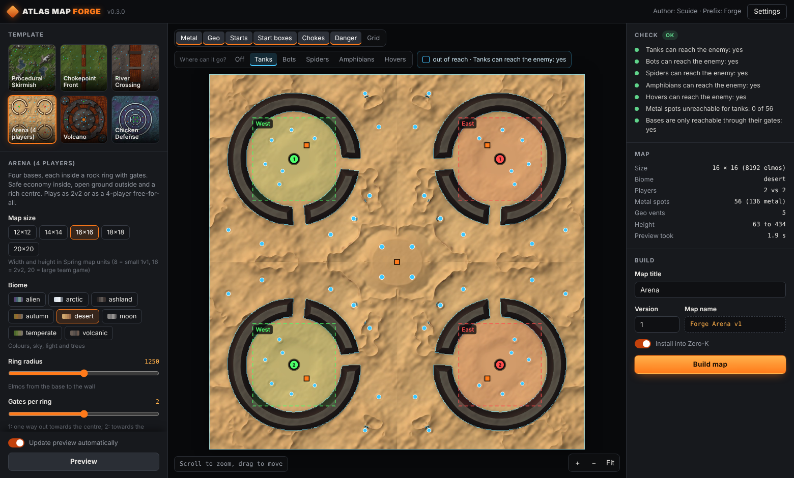

# Atlas Map Forge

A map generator for [Zero-K](https://zero-k.info). It builds complete, ready-to-play `.sdz` maps:
heightmap, high-resolution texture, minimap, metal spots, geovents, start boxes, trees, and optional
map gadgets such as lava cliffs, lava tides and an erupting volcano.

> **Status: pre-release (0.4).** 25 map templates, a Windows app with a large map preview and a placement
> editor, and the command line. See the [roadmap](docs/ROADMAP.md).

## Download

Get `AtlasMapForge.exe` from the [releases page](https://github.com/Scuide/atlas-map-forge/releases): one
file for Windows, no installation and no Python needed. The program is not code-signed yet, so Windows
SmartScreen asks first: click **More info**, then **Run anyway**. On first start, enter your author name
in Settings.

## What you get

- **Playable maps:** every map is checked with the engine's own slope rules. Ramps are carved
  automatically until tanks can reach the enemy base and every metal spot.
- **Good looks:** biome palettes (temperate, desert, arctic, volcanic, ashland, alien, moon, autumn, jungle, swamp,
  industrial, asteroid), a painted sky per map, engine grass, time of day,
  slope-based rock, shores, detail normal maps, splat materials and soft terrain transitions.
- **Fair layouts:** two-team symmetry (diagonal, north/south, east/west) for terrain and resources.
- **Map gadgets:** maps can carry their own Lua rules, for example damaging lava on cliffs that only
  spiders can climb, or lava tides with an on-screen countdown.
- **Your name on it:** maps are named `Forge <title> v<version>`, carry your author name and show a
  small FORGE badge in the map browser (not in game). The author name is the only setting and is
  required to build maps.

## The app



1. Pick a template on the left and move the sliders. The preview updates in about a second.
2. Look at the map: scroll to zoom, drag to move. Switch metal spots, start boxes, chokes and dangerous
   ground on and off. **Where can it go?** darkens the ground a unit class (tanks, bots, spiders,
   amphibians, hovers) cannot reach from the start points. The bar at the bottom shows the height under
   the mouse and which unit classes can drive there.
3. Read the check on the right, give the map a title and press **Build map** (enter your author name
   in Settings first; the app asks for it on the first start). The map is written to
   `Documents\Atlas Map Forge` and installed into Zero-K (the Zero-K folder is found automatically).

**Settings for every template:** metal amount, tree density, rocks, wrecks and erosion (rain-carved
valleys on natural slopes; bases, metal spots, chokes and ramps stay as designed). Rocks and crystals are
3D models generated for each map; wrecks are Zero-K unit wrecks. Both give reclaimable metal.

**Advanced mode** (Settings): lifts the limits of every map setting, for example map sizes from 4 to 32,
up to 8 gates or extreme wall heights. The app warns before switching it on: such maps can be unplayable
or fail to build. Values beyond the safe range are shown in orange.

Keys: `F` fit, `+`/`-` zoom, `R` new seed, `M` metal, `S` starts, `B` start boxes, `G` grid,
`1`-`5` unit class routes, `0` routes off.

**Windows:** download `AtlasMapForge.exe` from the [releases](https://github.com/Scuide/atlas-map-forge/releases)
and run it, no installation needed. The first start takes a few seconds while the program unpacks.

**With Python** (any system):

```
pip install "atlas-map-forge[app] @ git+https://github.com/Scuide/atlas-map-forge"
atlasforge app
```

Without the `[app]` extra (pywebview), the app opens in your web browser instead of its own window.

### Editor

In the preview you can move, add and delete metal spots, geothermal vents and start points. Symmetry
(mirror or rotation, including free-for-all) is applied to every edit, and live checks flag water, slope,
distances and fairness. Ctrl+Z and Ctrl+Y undo and redo. **Save project** writes a `.forge.json` file
(template, settings, seed and edits) that **Open project** loads again. Terrain brushes are planned for the next
stage.

## Install (command line)

Python 3.9 or newer:

```
pip install git+https://github.com/Scuide/atlas-map-forge
```

## Quick start

```
atlasforge config --author "YourName"
atlasforge templates
atlasforge preview chokepoint --set gates=4 --seed 3
atlasforge build chokepoint --set gates=4 --seed 3 --title "Iron Wall" --install
```

`preview` writes a picture and a check report in a few seconds. `build` makes `Forge Iron Wall v1.sdz`
and copies it into your Zero-K folder (found automatically for Steam installs; otherwise pass
`--install "C:\path\to\Zero-K"`). The build stops if the check finds a problem (`--force` builds anyway).

## Templates

| Template | What it is | Main settings |
|---|---|---|
| `skirmish` | Procedural Skirmish: noise terrain, 1v1 or teams | size, biome, style (hills, plateaus, canyon, islands, crater), team layout, relief |
| `chokepoint` | Chokepoint Front: West vs East split by a rock barrier with gates | gates 1-4, gate types (level, rock hump for bots, water channel for hovers), width, height, lava on top |
| `river` | River Crossing: river or lava lake with fords | lava tides / lava / water, fords 1-3, safe causeway, width, tide timing |
| `arena` | Arena: four bases in rock rings, rich centre, 2v2 or FFA | ring radius, gates per ring, wall height, centre |
| `volcano` | Volcano: volcano island in a lava sea, erupts on a schedule | calm and eruption length, lava bomb damage and rate, outer islands |
| `chicken` | Chicken Defense: nested ring walls with alternating gates | rings 2-3, gate width, wall height |
| `open_sea` | Open Sea: coastal bases facing a broad ocean with underwater metal | sea depth, beach slope, coast, underwater metal share, offshore islands |
| `archipelago` | Archipelago: home islands and scattered expansion islands, winding fleet routes | island pairs, island size, scatter, sea depth |
| `straits` | Island Straits: long central islands split the sea into fleet passages | passages, passage width, island width, sea depth |
| `three_lanes` | Three Lanes: three parallel battle lanes divided by ridges, side crossings to switch lanes | ridge height and width, crossing width, central crossing |
| `coastal_front` | Coastal Front: a mainland front beside a broad coastal sea | mainland depth, headlands, sea depth, underwater metal share |
| `atoll` | Atoll: opposing island arcs around a contested lagoon with two deep entrances | atoll radius, ring width, entrance width, sea depth |
| `ffa_ring` | FFA Ring: free-for-all for 3 to 8 players, identical sectors around a rich centre | players, ridges or open borders, ridge height, pass width, centre |
| `asteroid` | Asteroid: a cratered rock in space (in the style of Apophis), 2 to 4 identical sectors, low gravity | players, centre (basin, mesa, flat), relief, craters, rough flanks, irregular edge, gravity |
| `highlands` | Procedural Highlands: Seeded highland regions become irregular mesas, rounded massifs or stepped uplands | teams face, relief, terrain distortion, highland form, terrain regions, terrace levels |
| `watershed` | Procedural Watershed: Seeded river branches carve braided channels, broad wetlands or dry ravines | teams face, relief, terrain distortion, watershed form, tributaries, channel scale, channel depth |
| `dune_sea` | Procedural Dune Sea: Changing winds and warped noise create long dune chains, crescent fields or intersecting star dunes | teams face, relief, terrain distortion, dune form, dune bands, dune height, rocky uplands |
| `open_dunes` | Open Dunes: Broad, low dune waves and open basins favour mobile armies and wide flanks | teams face, relief, terrain distortion, dune direction, dune height, dune spacing, rocky cover |
| `twin_plateaus` | Twin Plateaus: Each team starts on a high plateau with several deliberate ramps into a shared lowland | plateau height, plateau depth, ramps per plateau, ramp width, lowland hills |
| `lake_district` | Lake District: Several seeded lake basins interrupt a connected mainland | teams face, relief, terrain distortion, lake basins, lake size, lake depth |
| `river_delta` | River Delta: A central river fans into several channels around contested delta islands | relief, terrain distortion, river arms, delta spread, channel width, channel depth, crossing corridors, crossing width, crossing type |
| `fjord_coast` | Fjord Coast: Deep inlets cut into opposing mainlands and shelter local fleet approaches | sea depth, beach slope, coast irregularity, underwater metal share, geothermal vents, coastal inlets, inlet reach, inlet width, mainland depth |
| `chicken_mesa` | Chicken Mesa: Defend one shared high mesa against chicken waves using several ramps. When the outer approaches fail, fall back to a central position. | map size, biome, mesa height, mesa ramps, ramp width |
| `canyon_network` | Canyon Network: A seeded network of branching ravines creates parallel routes, exposed junctions and deliberate cross-canyon passes. Each seed reshapes the canyon layout and changes where armies can switch fronts. | map size, biome, teams face, relief, terrain distortion, network pattern, main canyons, cross connections, canyon width |
| `mountain_spine` | Mountain Spine: A winding mountain ridge divides the battlefield. Tanks use broad low valleys, bots cross shorter passes, and spiders can flank over the steep sides; each seed changes the ridge and pass positions. | map size, biome, teams face, relief, terrain distortion, ridge course, ridge width, pass width |

Sea maps are checked for ships (heavy ships need water deeper than 15 elmos), hovers and amphibians
instead of tanks and bots; the app shows a "Ships" route.

Every template also takes `--seed` and checks the result: which unit classes reach the enemy, through
which chokes, whether every metal spot is reachable, plus template-specific checks (for example "During an
eruption the teams are cut apart: yes").

## Procedural maps with all options

```
atlasforge procedural --title "Ashfall Ridge" --size 12 12 --biome volcanic --style plateaus --seed 7 --install
```

Options of `atlasforge procedural`:

| Option | Meaning |
|---|---|
| `--size W H` | map size in Spring units, even numbers from 4 to 32 (12 12 is a typical 1v1/2v2 size) |
| `--biome` | temperate, desert, arctic, volcanic, ashland, alien, moon, autumn, jungle, swamp, industrial, asteroid |
| `--style` | hills, plateaus, canyon, islands, crater |
| `--layout` | diag (NW vs SE), ns (north vs south), ew (west vs east) |
| `--seed` | any number; the same seed builds the same map |
| `--relief` | height scale, 1.0 = default |
| `--mex` | metal spots per side |
| `--version` | version number in the map name; raise it when you change a map you already shared |

Your author name (required before building): `atlasforge config --author "YourName"`. Every map gets
the `Forge` name prefix, the FORGE badge and "Made with Atlas Map Forge." in its description.

### Seeing your map in the lobby

Zero-K's map list only shows local maps when **"Only show featured maps"** is switched off in the lobby
settings. The installer also writes a minimap picture for the lobby.

### Sharing maps

Upload the `.sdz` on [zero-k.info](https://zero-k.info/Maps) so other players download it
automatically. Please give every changed map a new version number: two different files with the same
map name cause download conflicts.

## Development

```
pip install -e .[test]
pytest
```

Code layout:

| Module | Purpose |
|---|---|
| `atlasforge.terrain` | terrain building blocks (plateaus, pits, ring walls, roads, ramps), engine slope test |
| `atlasforge.procedural` | procedural skirmish maps |
| `atlasforge.templates` | map templates with declared parameters |
| `atlasforge.forge` | pipeline: template -> design -> check -> quick preview -> build |
| `atlasforge.render`, `materials` | texture, paint layers (lava, ice, scorch, concrete), detail materials |
| `atlasforge.formats`, `archive` | SMF/SMT/DDS writers, mapinfo and config files, the .sdz archive |
| `atlasforge.checks` | reachability per movement class |
| `atlasforge.gadgets` | map gadgets (Lua) and their settings |
| `atlasforge.install` | find Zero-K, install maps |
| `atlasforge.erosion` | hydraulic erosion (rain droplets), protected design areas |
| `atlasforge.models`, `decor` | procedural rock and crystal models (.s3o), feature definitions, placement of rocks and wrecks |
| `atlasforge.watermark` | hidden watermark: embed, detect, verify |
| `atlasforge.app` | the app: local web server (`server.py`), page (`web/`), window (pywebview) |

The Windows program is packed with PyInstaller (`packaging/atlasforge.spec`). The `windows-app` workflow
builds it, runs a self-test (preview and a full map build with the packed program) and, for a version tag,
creates a draft release.

## Support

Enjoying Atlas Map Forge? Support me on Ko-fi to help development: https://ko-fi.com/scuide

## License

GPL-2.0-or-later, see [LICENSE](LICENSE). Bundled font: Inter Display (SIL Open Font License),
see `atlasforge/assets/InterDisplay-LICENSE.txt`. Maps you build are yours.

Zero-K and the Recoil engine are separate projects; this tool only writes files they can load.
